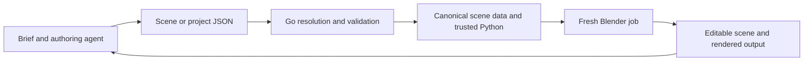

# Declarative interfaces for LLMs and the design of MoBlend

A language model asked to produce motion graphics faces two different problems: deciding what a scene should contain, and making a graphics application construct it correctly. Combining those problems in one generated script gives the model considerable freedom. It also makes the model responsible for object creation, API details, operation order, animation setup and the state left behind by earlier attempts.

MoBlend explores a different allocation of responsibility. An agent describes a supported scene in JSON. A Go tool validates and compiles that description, then runs trusted Blender Python against a bundled asset pack. Blender produces the scene and images. The central hypothesis is that a bounded declarative interface can make this workflow more reliable by moving repetitive implementation decisions out of the model's output and into tested software.

That is an architectural thesis with practical consequences, rather than a claim that JSON makes models understand design or that declarative programming always beats imperative programming. Its value depends on the contract, the implementation and the feedback available to the authoring agent.

## The observation that started MoBlend

MoBlend began with [a conversation with Gemini about agent-driven motion graphics](https://share.gemini.google/Pg4AEGlNs6K9). The initiating observation was that Remotion seemed approachable for language models because of its declarative authoring model. Remotion's documented model gives a React component access to the current frame and lets it describe the image to render. A composition combines that component with video metadata. This encourages authors to express how the output depends on time rather than replay a sequence of editor gestures. [Remotion describes this frame-based model in its core documentation.](https://www.remotion.dev/docs/idea)

React supplies the broader declarative idea: represent the relevant state and describe the interface associated with it, while the framework handles updates. Its documentation explicitly contrasts that approach with manually coordinating individual interface mutations. [React's explanation of declarative UI](https://react.dev/learn/reacting-to-input-with-state) is useful background even outside web applications.

The tempting conclusion is that LLMs are simply better at declarative programming. The more useful hypothesis is narrower: an interface may be easier for an agent to use when it exposes the desired result explicitly, reduces dependence on hidden state, and delegates well-understood execution mechanics to a runtime.

Familiarity with React, examples, tooling and feedback could also contribute to success with Remotion. A comparison that ignores those factors cannot attribute an advantage to declarative semantics alone. Remotion also remains a general programming environment; React code can contain arbitrary logic and external dependencies. Its interface is not the same as MoBlend's restricted scene language.

The question behind MoBlend was whether Blender could offer a similarly inspectable authoring surface while retaining its rendering and asset ecosystem. The resulting project applies that idea to a bounded set of Blender capabilities.

## Where hidden state creates work

Consider a brief asking for a product cube on a pedestal, followed by a change to the cube's colour and animation.

In an interactive automation workflow, the agent may need to know whether the cube already exists, which object is selected, which mode Blender is in, whether a material is shared with another object, and whether an earlier attempt inserted keyframes. The next command can be locally reasonable and still affect the wrong object or preserve stale state.

This is a concrete concern for Blender operators. Blender's API documentation explains that operators use context and may depend on the active area, selection or active object. A command can fail because its context is unsuitable. [Blender's operator guidance](https://docs.blender.org/api/main/info_gotchas_operators.html) describes these limitations.

It would be misleading to equate all Blender Python with fragile UI automation. A carefully written script can use explicit data references, avoid unnecessary operators, reset its environment and rebuild a scene predictably. That is exactly the kind of engineering MoBlend wants to reuse. The distinction is who must get those details right on each authoring attempt.

An MCP connection does not settle the issue either. MCP can expose low-level mutations, a high-level declarative scene submission, or both. The reliability question concerns the semantics and state requirements of those tools, not the transport used to invoke them.

With a declarative source document, the agent can inspect the intended scene directly. Changing a colour means changing a property associated with a stable ID. The tool then reconstructs the scene from its known starting point. The agent has less execution history to reconstruct from conversation or infer from a live session.

That advantage comes from explicit state and controlled reconstruction. Merely putting a list of imperative commands inside JSON would retain the original sequencing problem.

## How the declarative boundary can help an agent

A useful declaration narrows the set of decisions the author must make. The author chooses a supported object, its properties and its animation. The implementation owns the Blender calls that realize those choices. There are fewer opportunities for generated code to invent an API call, confuse a socket binding or omit setup that every scene requires.

The reduction is deliberate. MoBlend does not attempt to describe every possible Blender operation. Its catalogue exposes selected assets and parameters, and its language supports bounded scene construction. A narrower interface is valuable when it covers the user's task; it becomes an obstacle when the task requires capabilities outside that boundary.

The declaration also creates a place to check mistakes before rendering. Different checks establish different facts:

| Check | What it can establish | What it cannot establish alone |
|---|---|---|
| Parsing and schema validation | The document has an accepted structure and field types | The requested object references exist or the scene matches the brief |
| Semantic validation | References, capabilities, values and resource limits satisfy implemented rules | Blender bindings are correct or the image is attractive |
| Compilation checks | Supported input becomes stable execution artifacts | Those artifacts produce the intended Blender scene |
| Scene probes and rendering | The runtime produced inspected properties and outputs | The user considers the result successful |
| Visual and brief review | The inspected result meets stated criteria | Every possible frame, environment or future change will behave correctly |

This separation improves diagnosis. An unknown asset can produce a catalogue error. A bad animation target can point to a field in a module. A clipped title can be identified during preview review. These problems call for different repairs; collapsing them all into “the render failed” leaves the agent guessing.

Declarations can also make revisions more local. A request to change one chart's values can be expressed as a small source edit with an inspectable diff. That does not eliminate coordination or interpretation, but it gives both people and agents a stable artifact against which to check the change.

The expected benefit is fewer avoidable implementation errors and better repair information. Whether that produces higher task success or lower cost for a particular model remains a measurement question.

## What MoBlend actually delegates

MoBlend's execution path is:



The model works at the brief-to-declaration boundary. The Go application resolves local modules, validates input and prepares deterministic job artifacts. The current compiler emits canonical scene data alongside a trusted Python application script; it does not ask another model to invent the implementation behind each declaration. Blender remains the runtime that constructs and renders the scene.

For example, an animation track inside a valid scene might declare:

```json
{
  "target_id": "product",
  "property": "location",
  "interpolation": "linear",
  "keys": [
    { "frame": 1, "value": [0, 0, 0] },
    { "frame": 21, "value": [2, 0, 0] }
  ]
}
```

This is a track fragment, not a complete scene: the scene must define `product` and a frame range containing both keys. It specifies a relationship between time and position. The author does not have to generate the Blender keyframe-insertion and interpolation setup. A scene probe can independently check that the X position is approximately 1 at frame 11.

Much remains for the author to decide. The product may be badly framed, poorly lit or animated in a way that contradicts the brief. MoBlend's declaration is explicit scene specification, not an automatic composition solver. The compiler gives defined meaning to supported choices; it does not supply artistic judgment for unspecified ones.

The same division applies to assets. A Geometry Nodes asset can expose a tested set of controls while hiding the internal node construction from the authoring agent. The author declares input values. Asset authors and tool maintainers own the bindings and implementation. That creates a reusable contract, with the corresponding responsibility to test it when Blender or the asset pack changes.

Go is a practical implementation and distribution choice for this boundary. A Go executable can carry the schemas, catalogue, templates and asset pack, while Blender remains a separate prerequisite. The thesis would not become false if another implementation language fulfilled the same contract. Its essential properties are explicit semantics, validation, repeatable execution and useful feedback.

## Declarative authoring needs disciplined execution

A declaration does not automatically make a system deterministic, idempotent or safe.

A loader could resolve imports differently depending on filesystem order. A backend could append another object every time the same document is applied. User text could be interpolated carelessly into executable source. Defaults could change without a version boundary. Any of these choices would undermine the value of the declarative surface.

MoBlend's design addresses this with explicit local imports, stable identifiers, validation, separation of data from trusted Python, versioned contracts and fresh jobs built from a known asset pack. The intended outcome is that retrying a build reconstructs the same specified scene rather than applying another mutation to a partly understood previous result. The imperative work still exists, and needs testing; it is concentrated in a maintained implementation.

Compiler determinism also has a precise scope. Equivalent supported input should produce stable canonical data and script artifacts for the same tool and resources. That does not imply byte-identical saved Blender files or identical pixels across Blender versions, operating systems and GPUs. Rendering has additional environmental dependencies.

This boundary makes many errors easier to contain, but is not a general sandbox for hostile code or arbitrary third-party assets. MoBlend's constrained input and bundled assets are part of its scope, not permission to accept every file Blender could load.

## Modularity is part of the reliability argument

A complete declaration is useful as a source of truth. Requiring the whole production to fit in one giant document would make that source increasingly difficult to inspect and change.

MoBlend therefore supports explicit local modules and independently selected shots. Modules provide file-sized ownership boundaries, namespaces distinguish entities, and imports expose dependencies. Source-aware diagnostics can direct an agent to the original file and field even after declarations have been resolved into a scene.

For a production with separate opening, product and closing shots, an agent working on the closing title can focus on its entry, relevant modules and import contracts. It does not need to reconstruct the entire production to make a local edit. Selecting a shot also bounds the immediate build and preview task.

This does not make independent edits automatically conflict-free. A shared camera convention, namespace or imported module still needs coordination. Nor does splitting files remove per-scene resource limits. The benefit is that dependencies and ownership become inspectable, rather than being embedded only in a long conversation or mutation history.

MoBlend's no-RAG design is compatible with this approach. Agents can read the installed guide, relevant schemas, exact-ID asset descriptions and selected project files directly. A compact explicit contract can be supplied on demand without a vector database or semantic retrieval service. Whether that remains sufficient for a much larger asset catalogue is a future product question.

## What the research supports and what still needs testing

Related work supports pieces of this design reasoning. PICARD constrains language-model generation through incremental parsing, rejecting inadmissible output tokens in text-to-SQL tasks. Its reported results show that formal-language constraints can improve those tasks. MoBlend instead validates submitted declarations; it does not itself constrain a model's token decoding. [The PICARD paper](https://arxiv.org/abs/2109.05093) supports the value of machine-checkable structure in its studied setting, not a universal result for graphics.

Program-aided Language Models, or PAL, delegates execution of generated intermediate programs to an interpreter in mathematical and symbolic tasks. It illustrates another useful division: let a model express a solution and let software perform executable operations. PAL uses general programs, so it is not evidence that a restricted declarative format is necessarily superior to Python. [The PAL paper](https://arxiv.org/abs/2211.10435) supports that narrower observation about delegation.

For MoBlend, a convincing evaluation would compare the same supported briefs across direct Blender Python and MoBlend authoring, using the same models, comparable documentation, the same assets and render settings, and equal repair and tool budgets. A third condition using a well-designed Python helper library would help separate the value of abstraction and reusable code from the value of a declarative format specifically.

Measure valid first attempts, success after bounded repair, preserved user intent, unrelated changes, visual quality, execution failures, elapsed time and model cost. Include changes to existing scenes and multi-shot projects as well as initial construction. Freeze prompts and scoring criteria before running comparisons, retain failed attempts and repeat runs to capture variation.

A Remotion comparison would answer a different question unless the tasks and capabilities were carefully matched. Differences in renderer, assets, layout facilities and authoring ecosystem would otherwise be confounded with the interface style.

As of 5 November 2026, MoBlend has implementation tests and recorded development exercises, but the canonical project state still treats the proposed model repair-loop qualification as unmet. Those records should not be presented as a controlled demonstration that declarative authoring is better. The stronger claim remains a hypothesis to evaluate.

The design already expresses a concrete position: for a bounded creative domain, give the model an explicit description to author, a maintained runtime to execute it and visible evidence to revise against. MoBlend makes that position testable by preserving the declaration, the compiler artifacts, the Blender scene and the rendered result. Its long-term value depends on how well those layers carry the user's intent through actual production work.
